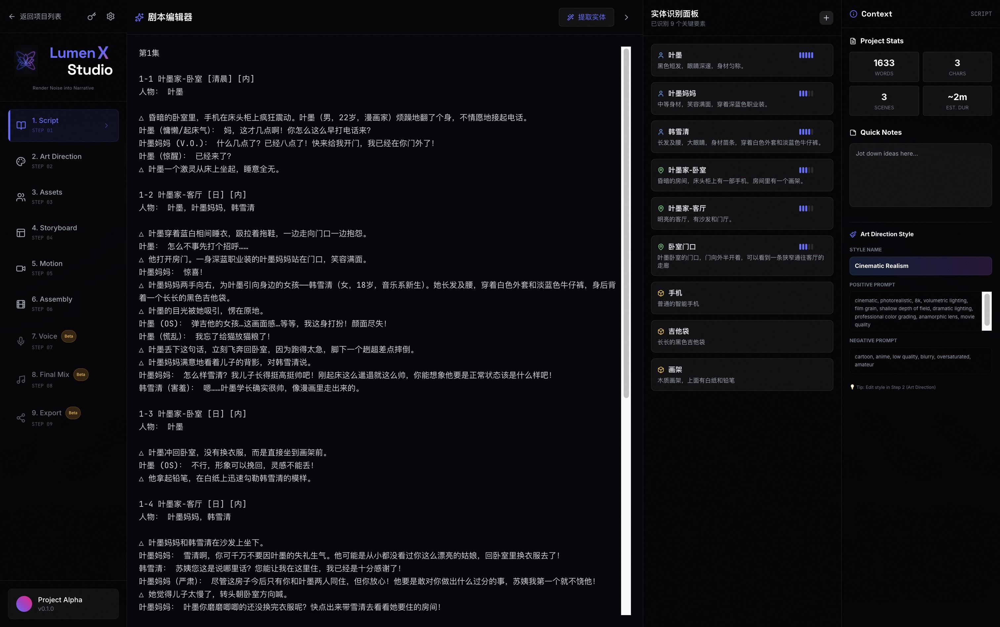
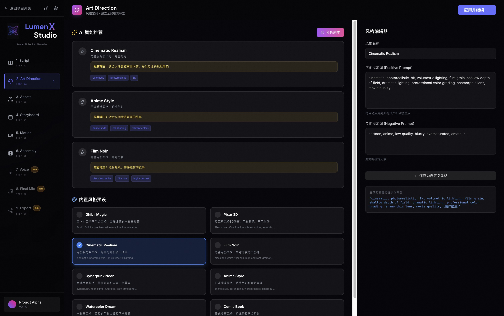
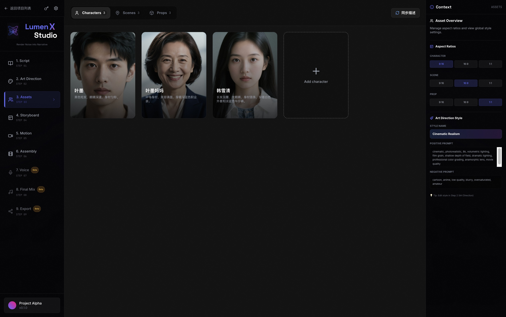
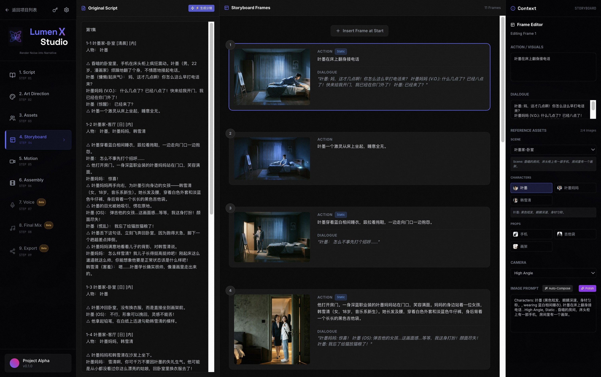

<!-- Banner -->
<div align="center">
  
</div>

<div align="center">

# LumenX Studio

### AI 原生短漫剧创作平台
**Render Noise into Narrative**

[](CHANGELOG.md)
[](LICENSE)
[](https://www.python.org/)
[](https://nodejs.org/)

</div>

---

LumenX Studio 是一个 **AI 短漫剧一站式生产平台**，将小说/剧本文本转化为可发布的漫画风格视频，打通 **剧本分析 → 风格定调 → 资产生成 → 分镜构造 → 分镜图/分镜视频生成 → 配音配乐 → 成片合成** 的完整创作链路。

平台将短漫剧行业的制作 SOP（资产提取、风格统一、角色一致性维护、分镜脚本构造）天然集成到产品功能中，并接入多家模型服务商，无需在多个网页/App 之间切换，即可一站式完成短漫剧制作。

## ✨ 核心亮点

| 能力 | 描述 |
|------|------|
| 📝 **深度剧本分析** | 基于 LLM 自动提取角色、场景、道具，生成专业分镜脚本；支持多集系列创作（上一集摘要、下集钩子） |
| 🎨 **可控美术指导** | 风格分析 / 预设风格库，以正负提示词建立全局统一视觉标准 |
| 🧍 **角色一致性资产库** | 角色全身图 → 三视图/头像特写，`reference_sheet` 一次生成角色设定图；资产锁定、变体管理与一致性金库（Consistency Vault） |
| 🎬 **可视化分镜编辑** | 拖拽式分镜编辑器（Storyboard Composer / Frame Editor / Workbench），所见即所得组合人物、背景与提示词 |
| 🎥 **R2V 参考生视频** | 以角色/场景资产图为参考直接生成视频，8 个 R2V 模型跨 6 个模型族可选，独立于 T2V 分组 |
| 🗣️ **智能视听合成** | 音色克隆 / 音色设计、对白批量配音、BGM 与音效（SFX）生成、多轨音频混音、成片合成 |
| 🧩 **多模型市场** | 模型按族分组展示（GroupedModelGrid），YAML 目录驱动，支持为每个项目切换模型与提示词配置 |

## 🤖 支持的模型

| 类型 | 服务商 / 模型 |
|------|--------------|
| 文本（LLM） | DashScope（通义千问 Qwen）、OpenAI 兼容接口（DeepSeek / Ollama 等）、Agnes |
| 图像生成 | 万相 Wanx（DashScope）、GPT-Image-2（MuleRun/MuleRouter）、Agnes、本地 ComfyUI |
| 视频生成 | Seedance 2.0（MuleRun，支持 T2V / I2V / **R2V**）、可灵 Kling、Vidu、豆包（火山 Ark）、Agnes |
| 视觉理解 | Qwen-VL（分镜与图片理解） |

> 只需一个 `DASHSCOPE_API_KEY` 即可跑通基础流程（Qwen + Wanx）；其余服务商按需配置。

## 📸 产品演示

<div align="center">

**Step 1 · 剧本编辑与实体提取** — 左侧编辑剧本，Qwen 自动提取角色、场景、道具，右侧调整实体设定。



**Step 2 · 风格定调** — 由 LLM 分析剧本适配风格或使用预设风格，建立全局视觉标准。



**Step 3 · 资产生成** — 为角色/场景/道具生成设定图，角色先出全身图再衍生三视图与特写，保证全片一致性。



**Step 4 · 分镜与视频** — 分镜编辑器组合资产生成画面，再以 T2V/R2V 生成动态分镜视频并合成成片。



</div>

## 🚀 快速开始

### 环境要求

- Python 3.11+
- Node.js 18+
- FFmpeg（加入 PATH；Windows 可放置于项目 `bin/` 目录）

### 1. 配置 API Key

```bash
cp .env.example .env
# 编辑 .env，至少填写 DASHSCOPE_API_KEY
# 其余（Kling / Vidu / MuleRun / Agnes / OSS / ComfyUI / LLM Provider）按需选填
```

### 2. 启动后端（FastAPI，端口 17177）

```bash
pip install -r requirements.txt
mkdir -p output/uploads

# Linux / macOS
./start_backend.sh
# 或
python -m uvicorn src.apps.comic_gen.api:app --reload --host 0.0.0.0 --port 17177
```

API 文档：<http://localhost:17177/docs>

### 3. 启动前端（Next.js）

```bash
cd frontend
npm install
npm run dev
# 开发模式访问 http://localhost:3008
```

### 4. 桌面应用模式（pywebview）

```bash
python main.py
```

### 5. Docker 部署

```bash
docker-compose up -d
# backend:  http://localhost:17177
# frontend: http://localhost:3000
```

### Windows 安装包

前往 [Releases](https://github.com/20230608xiaoyi/LumenXStudioN/releases) 下载 `LumenXStudio_Setup.exe` 双击安装。

## 📁 项目结构

```
LumenX/
├── src/
│   ├── apps/comic_gen/     # 核心业务
│   │   ├── api.py          # FastAPI 路由（约 110 个端点）
│   │   ├── pipeline.py     # 全流程编排
│   │   ├── models.py       # Pydantic 数据模型
│   │   ├── assets.py / storyboard.py / video.py / audio.py / export.py
│   ├── models/             # 模型封装（wanx / kling / vidu / doubao / mulerouter / agnes / comfyui / qwen_vl）
│   └── config.py           # 全局配置
├── frontend/               # Next.js 14 + React 18 + Zustand + Tailwind
│   └── src/components/modules/   # 21 个功能模块（剧本/风格/资产/分镜/视频/时间线…）
├── config/                 # 模型目录等 YAML 配置
├── docker/                 # Docker 部署文件
├── scripts/                # 构建/打包脚本
├── output/                 # 生成产物（资产图、分镜、视频片段、成片）
└── docs/                   # 文档与产品截图
```

## 📚 文档

- [用户手册](USER_MANUAL.md)
- [更新日志](CHANGELOG.md)
- [贡献指南](CONTRIBUTING.md)

## 📄 License

[MIT](LICENSE)
